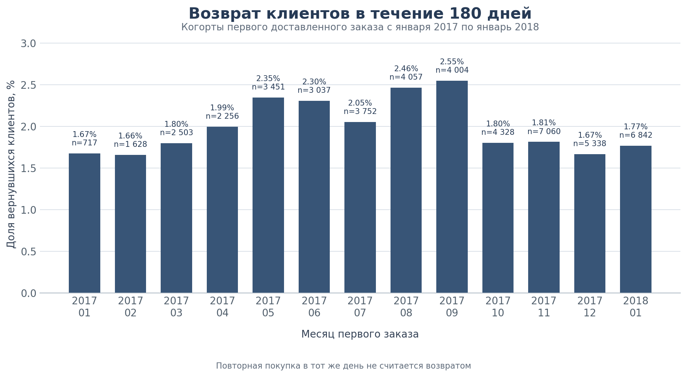

# Когортный анализ возврата клиентов Olist

Учебный SQL-проект на данных бразильского маркетплейса Olist. Цель работы понять, как часто клиенты возвращаются после первого доставленного заказа и связаны ли повторные покупки с опытом первой доставки и оценкой заказа.



## Задача

Для каждого покупателя определён первый доставленный заказ. Возвратом считается следующий доставленный заказ в другой день, сделанный не позднее чем через 180 дней после первого. Покупка в тот же день не считается возвратом.

Анализ отвечает на три вопроса

- Как меняется доля вернувшихся клиентов между когортами первого заказа
- Возвращаются ли реже клиенты, чей первый заказ доставили позднее обещанной даты
- Связана ли низкая оценка первого заказа с меньшей вероятностью повторной покупки

## Данные и стек

Использован Brazilian E-Commerce Public Dataset by Olist с заказами, клиентами, товарами, продавцами и отзывами за 2016-2018 годы. В анализ попали доставленные заказы. Для когорт и гипотез взяты первые заказы с января 2017 по январь 2018, чтобы у каждого клиента было полное окно в 180 дней до завершения данных.

Стек

- PostgreSQL
- SQL с CTE, оконными функциями, условной агрегацией и внешними ключами
- Python, pandas и SciPy для статистических проверок

## Что сделано

- Создана реляционная схема из таблиц Olist с первичными и внешними ключами
- Проведена разведка данных и выбран горизонт наблюдения 180 дней
- Построен когортный анализ по месяцу первого доставленного заказа
- Проверена гипотеза о связи задержки первой доставки с возвратом
- Проверена гипотеза о связи оценки первого заказа с возвратом
- Рассчитаны χ²-тесты, доверительные интервалы для разницы долей и MDE

## Результаты

| Показатель | Результат |
| --- | --- |
| Клиенты с хотя бы вторым доставленным заказом | 2 801 из 93 358, около 3% |
| Медиана между первым и вторым заказом | 53 дня |
| Возврат за 180 дней по когортам | от 1,66% до 2,55% |
| Средний возврат за 180 дней | 1,99% |
| Возврат при доставке вовремя | 2,01% |
| Возврат при опоздании первого заказа | 1,65% |
| χ²-тест для задержки доставки | p = 0,190, различие незначимо |
| Возврат при оценке 1-3 | 1,74% |
| Возврат при оценке 4-5 | 2,06% |
| χ²-тест для оценки первого заказа | p = 0,036, различие значимо |

## Бизнес вывод

Повторные покупки у Olist редки, в каждой когорте за полгода возвращаются примерно 2% клиентов. Самая высокая доля возврата была у когорты сентября 2017 года, 2,55%, но устойчивого роста между когортами нет.

Клиенты с опоздавшей первой доставкой возвращались немного реже, 1,65% против 2,01%, но данных недостаточно, чтобы считать эту разницу подтверждённой. Усиливать программу удержания только за счёт сокращения опозданий на этих данных не стоит.

У клиентов с оценкой первого заказа 4-5 возврат выше, 2,06% против 1,74% для оценок 1-3. Разница небольшая, но статистически значимая. Низкая оценка подходит как сигнал для точечной коммуникации после заказа, например промокода или запроса обратной связи.

## Ограничения

- Датасет заканчивается в 2018 году, поэтому поздние когорты не подходят для полного 180-дневного наблюдения
- Оценка могла быть оставлена уже после повторной покупки, поэтому связь оценки и возврата нельзя трактовать как причинный эффект
- В наборе нет маркетинговых касаний, цены привлечения и подробной истории коммуникаций с клиентом
- Проект основан на публичном учебном датасете и не описывает текущие показатели компании Olist

## Структура проекта

```text
.
├── 01_create_tables.sql
├── 02_exploration.sql
├── 03_cohorts.sql
├── 04_hypotheses.sql
├── 04_hi_square_mde.ipynb
├── 05_hypotheses_reviews.sql
├── 05_review_score_chi_square.ipynb
├── docs
│   ├── er_diagram.png
│   └── cohort_retention_180_days.png
└── scripts
    ├── import_reviews.psql
    └── README.md
```

## Файлы

| Файл | Содержание |
| --- | --- |
| `01_create_tables.sql` | Таблицы Olist, ключи и проверки связей |
| `02_exploration.sql` | Разведка данных и выбор горизонта возврата |
| `03_cohorts.sql` | Когортный анализ возврата за 180 дней |
| `04_hypotheses.sql` | Проверка гипотезы про задержку доставки |
| `04_hi_square_mde.ipynb` | χ²-тест, доверительный интервал и MDE для задержки доставки |
| `05_hypotheses_reviews.sql` | Проверка гипотезы про оценку первого заказа |
| `05_review_score_chi_square.ipynb` | χ²-тест, доверительный интервал и MDE для оценки |
| `docs/er_diagram.png` | ER-диаграмма базы |
| `scripts/import_reviews.psql` | Загрузка исходных отзывов через psql |

## Как посмотреть проект

1. Скачать исходные CSV Olist и импортировать таблицы в PostgreSQL
2. Выполнить `01_create_tables.sql` и загрузить данные в созданные таблицы
3. Для отзывов выполнить `scripts/import_reviews.psql` по инструкции в `scripts/README.md`
4. Запустить SQL-файлы по порядку от `02_exploration.sql` до `05_hypotheses_reviews.sql`
5. Открыть ноутбуки с расчётами статистических тестов
